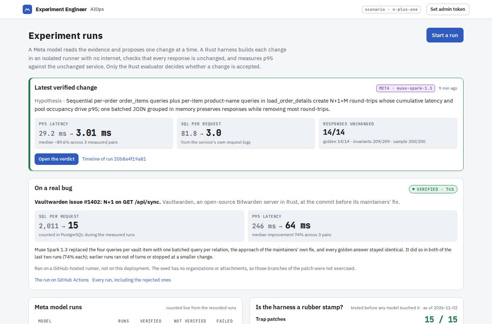

# AIOps Experiment Engineer: the AI proposes, a Rust harness proves

AI models write plausible performance fixes in seconds. Knowing whether a fix is correct, and whether it really made the service faster, still takes an engineer an afternoon. This project closes that gap without trusting the model.

A Meta model (Muse Spark 1.3, through the Meta Model API) reads operational evidence, states a hypothesis and writes a patch. A Rust harness builds the patch in an isolated container with no internet and no secrets, checks that every response is unchanged, and measures p95 latency against the unchanged service in alternating pairs. Only the Rust evaluator decides: **VERIFIED**, **REJECTED** or **INCONCLUSIVE**, each with the measured reason. The model can propose; it cannot pass its own patch.

[한국어 README](README.ko.md)

- **Live:** https://aiops-edge.yh9365.workers.dev (Cloudflare Workers, Containers, D1, R2). Reading is public; starting a run needs the admin token.
- **On a real bug:** on Vaultwarden's documented N+1 (issue #1402, an open-source Rust Bitwarden server), the model's batched rewrite cut SQL per sync from 2,011 to 15 and p95 from 246 to 64 ms, and was VERIFIED (74%). See [the real-bug write-up](docs/real-bug-probe.md).
- **Best run to open:** [`/runs/01a19da7-b2a2-70e0-af44-018eddd0c003`](https://aiops-edge.yh9365.workers.dev/runs/01a19da7-b2a2-70e0-af44-018eddd0c003). The model's first patch did not match the source, so the harness refused it before anything ran. The model read the refusal, fixed the patch, and the second one was VERIFIED.
- **Stack:** Rust (Axum, Tokio, SQLx), React (Vite, TypeScript), Cloudflare Workers + Containers + D1 + R2, Meta Model API.



## How one run works

1. **Baseline.** The runner measures the unchanged service twice under the same fixed load (A/A). If two runs of the same code differ by more than 15%, nothing is judged.
2. **Observe.** The observer role calls tools to read metrics, the slowest requests (each with its SQL count and DB time), the source and past experiments. It writes facts and hypotheses separately, every fact with an evidence ID.
3. **Propose.** The experimenter role writes one hypothesis, what result would prove it wrong, and a search/replace patch.
4. **Check before running.** The patch must touch only allowed files (never the request tracker, the golden answers or `Cargo.toml`), and each search text must match the source exactly once.
5. **Build and verify.** The runner applies the patch in a fresh workspace and builds it offline. It then compares the candidate with the original on 14 golden cases, checks response invariants, and compares 200 sampled requests answered by both.
6. **Measure.** Baseline and candidate run alternately in 3 pairs at 100 requests per second. Each pair gives one p95 improvement.
7. **Decide.** The evaluator applies the gates below. A REJECTED or INCONCLUSIVE result goes back to the model with its reasons, and the model may try again within its budget (3 candidates, 20 model turns, 40 tool calls, 30 minutes).

| Gate | Fails when | Verdict |
| --- | --- | --- |
| Policy | a protected or out-of-scope file, or a search text that does not match exactly once | POLICY_REJECTED, nothing runs |
| Build | the candidate does not compile | EXECUTION_ERROR |
| Correctness | any golden case, invariant or sampled response differs, or the candidate crashes | REJECTED |
| Trust in the measurement | baseline pairs vary more than 15%, or the baseline cannot keep up with the load | INCONCLUSIVE, measured once more |
| Errors and load | the candidate's error rate rises above the baseline's, or it falls behind the load while being slower | REJECTED |
| Improvement | median p95 improvement ≥ 20% and every pair improved | VERIFIED |
| | every pair misses 20% by more than the measured noise, or the candidate is slower | REJECTED |
| | anything in between | INCONCLUSIVE |

Every verdict is stored with the scenario hash, the patch hash, the measurement environment and the raw reports, so the same experiment can be run again.

## Results on Cloudflare with Meta models

All runs below used the deployed system. The scenario is an order-list API whose handler loads line items and product names one query at a time (N+1). The full table with every run ID is in [docs/plan.md](docs/plan.md) under "모델 비교".

| Model | Runs | Reached VERIFIED | Notes |
| --- | --- | --- | --- |
| `muse-spark-1.3` (default) | 9 | 8 | One run was stopped by our own deploy before the model was called. Two runs needed a second candidate: one first patch was refused by the policy gate, one was INCONCLUSIVE twice because of measurement noise |
| `muse-wonder-1.0` | 4 | 2 | One failure was ours: the output-token cap cut its answer off (fixed). In the other, the model wrote a full plan and then chose `stop` (now sent back for one repair, not yet seen in a live run) |

In every VERIFIED trial:

| Measure | Before | After |
| --- | --- | --- |
| SQL statements per request | 81.8 | 3.0 |
| p95 latency at 100 rps | about 17 ms | about 2 ms |
| Median pairwise p95 improvement | | 87.7% to 90.1% |
| Golden cases / sampled requests | | all passed |


Every run named the same cause and proposed the same kind of fix (one batched JOIN), but the patch text was different every time. Each patch therefore had to be verified on its own.

### On a real bug: Vaultwarden

The scenario above is hand-written, so we also ran the loop on a real, documented bug: Vaultwarden issue #1402, an N+1 on `GET /api/sync`, at the commit before its maintainers fixed it. These runs used a GitHub-hosted runner, not the Cloudflare deployment.

| | Before | After (model's patch) |
| --- | --- | --- |
| SQL statements per sync (500 vault items) | 2,011 | 15 |
| p95 at 8 requests per second | 246 ms | 64 ms |
| Median pairwise improvement | | 74.2%, VERIFIED |

- The model wrote a batched rewrite, one query per relation, which is the approach of the maintainers' own fix. It did so in both runs after the harness changes this bug led to. Every golden answer stayed identical.
- The earlier runs are part of the result. One ran out of model turns, one patch was refused for an ambiguous search text, one rewrite did not compile, and a smaller correct change measured 18% on one machine (REJECTED) and 21% on another (VERIFIED).
- The seed has no organizations or attachments, so those branches of the patch were not exercised by the correctness checks.

All runs, the method and the harness changes are in [docs/real-bug-probe.md](docs/real-bug-probe.md).

## How we tested the harness itself

A harness that says VERIFIED to everything would also produce the numbers above. So we attacked it.

- **15 trap patches, one per gate.** Each is a hand-written patch built to fail exactly one gate: dropping items, shifting a page, leaking another user's orders, rounding totals, editing the tracker or the golden answers, being slower, crashing on one product, racing under load, not compiling. In CI, inside the network-isolated runner image, all 15 got the expected verdict for the expected reason ([Harness suite run](https://github.com/qlanfr/mata_Hackathon/actions/runs/41502956337)). These are our patches, not model output.
- **36 generated mutants.** A script mutates the handler with fixed rules (comparison operators, binds ±1, loop order, arithmetic, deleted statements). The correctness gates caught 30. Of the other 6, 4 cannot change any response, and 2 happen to give the same result on this data (an `ORDER BY` removed where PostgreSQL returns insertion order anyway). See [docs/mutation-results.md](docs/mutation-results.md).
- **Bugs this found in our own harness**, all fixed:
  - The golden cases let a wrong item order pass. A trap patch that sorted items by product ID got VERIFIED until we added a case.
  - Mutation testing found two more golden gaps: an unknown user ID below the highest real ID, and the last user.
  - On a cold runner, cargo skipped the candidate build and the "candidate" was the original binary. This could only hide improvements, never invent one.
  - During a rollout, an old and a new orchestrator advanced the same run. A D1 lease and a compare-and-swap guard now prevent it.

## Scope and limits

- **Two scenarios, both N+1.** The deployed one is hand-written; the second is a real bug in Vaultwarden, run in GitHub Actions. The gates themselves know nothing about N+1 and judge any patch the same way, but other kinds of performance problems have not been tried.
- **The real-bug scenario is not deployed.** The deployment loads one scenario; choosing the scenario per run is the next change.
- **Target shape.** Today the runner targets a Rust HTTP service on PostgreSQL, built offline from dependencies baked into the image. Adding another service is a scenario file, a seed and a load script; see [docs/adding-a-service.md](docs/adding-a-service.md).
- **Correctness means "same as before".** Golden answers come from the original service, so a candidate must preserve existing behaviour. Invariants check a few rules that hold whatever the code, which also catches some bugs the original already had.
- **Fixed load.** Results hold for the scenario's load profile and data, not for every workload.
- **One experiment at a time.** There is one runner, and it runs one job at a time.

## Repository

| Path | What it is |
| --- | --- |
| `crates/aiops-core` | Scenario contract, patch policy, report types and the evaluator (all verdict rules) |
| `apps/aiops-runner` | Applies a patch, builds offline, runs correctness checks and k6 load, cleans up. CLI and HTTP job API |
| `apps/aiopsd` | Orchestrator state machine, control DB (D1 or SQLite), observer and experimenter roles with tools, Meta and Replay providers, API and SSE |
| `fixtures/orders-api` | The service under test, with the N+1 handler. Logs SQL count and DB time per request |
| `scenarios/n-plus-one` | Scenario contract, schema, seed, golden cases, load script, trap patches |
| `edge` | Cloudflare Worker: static UI, the two containers, relays to D1, R2 and the runner, 1-minute cron, write-API auth |
| `web` | React UI: runs, live timeline, trial result with gates, pairwise p95 chart, diff and reproduction data |
| `migrations` | Control DB schema, shared by D1 and local SQLite |

## Run it locally

PostgreSQL server binaries and k6 must be installed.

```bash
cargo test --workspace
```

```bash
cargo build --release -p aiops-runner -p aiopsd
```

```bash
./target/release/aiops-runner --pg-user postgres serve --listen 127.0.0.1:18080
```

```bash
./target/release/aiopsd --listen 127.0.0.1:18090 --runner-url http://127.0.0.1:18080
```

```bash
curl -s -X POST 127.0.0.1:18090/api/v1/runs -H 'content-type: application/json' -d '{}'
```

Without `META_API_KEY`, aiopsd uses the Replay provider, which plays back recorded model answers. The UI marks those runs `replay`. For the UI, run `npm ci && npm run dev` in `web`; it proxies `/api` to 127.0.0.1:18090. Deployment is described in [docs/setup.md](docs/setup.md) (Korean).

## Docs

- [docs/architecture.md](docs/architecture.md): deployment, run states, one trial, the gates
- [docs/adding-a-service.md](docs/adding-a-service.md): what it takes to point the harness at another service
- [docs/real-bug-probe.md](docs/real-bug-probe.md): the loop on a real bug (Vaultwarden #1402): reproduction, every run, and the harness changes it led to
- [docs/submission-text.md](docs/submission-text.md): project description for the submission
- [docs/plan.md](docs/plan.md) (Korean): plan, daily log, every measured run and every bug found
- [docs/mutation-results.md](docs/mutation-results.md): mutation testing results
