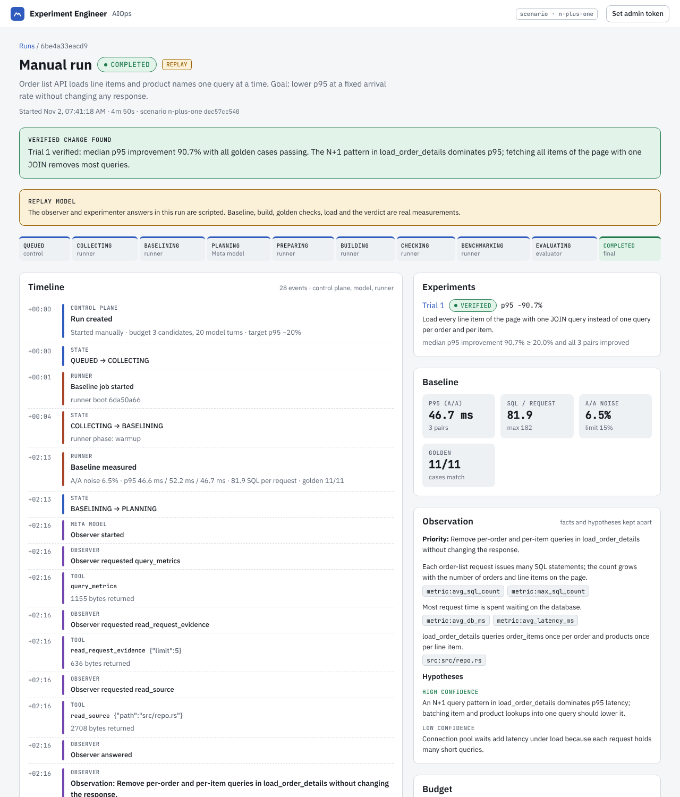
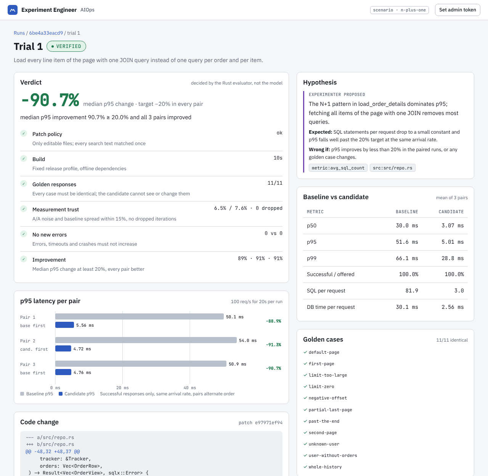

# AIOps 자율 실험 엔지니어

Meta 모델이 운영 증거를 읽고 성능 개선 가설과 패치를 제안합니다. Rust 하네스는 그 패치를 격리된 Cloudflare Container에서 빌드·검증·측정합니다. 채택 여부는 Rust 평가기만 판정합니다.

- 첫 시나리오: Rust 주문 목록 API + PostgreSQL의 N+1 조회
- 스택: Rust(Axum · Tokio) / React(Vite · TypeScript) / Cloudflare Workers + Containers + D1 + R2
- 상태: Cloudflare에 배포됨 — https://aiops-edge.yh9365.workers.dev .
  - 모델: Meta Model API의 `muse-spark-1.3`(관측·실험 역할).
  - 배포본에서 모델이 증거를 읽고 N+1을 찾아 패치를 제안했습니다. 하네스가 그 패치를 VERIFIED로 판정했습니다(run `01a19d86-d9d6-76d3-bced-54ae6d3475ec`, p95 쌍별 개선 88.6 / 87.7 / 88.3%, 요청당 SQL 81.8 → 3.0).

## 지금 동작하는 것

| 구성 요소 | 위치 | 역할 |
| --- | --- | --- |
| `aiops-core` | `crates/aiops-core` | 시나리오 계약, search/replace 패치 정책, 측정 보고서 타입, 판정 게이트(평가기) |
| `aiops-runner` | `apps/aiops-runner` | 패치 적용 → 빌드 → golden 검사 → k6 교대 측정 → 정리. CLI와 HTTP job API |
| 실험 대상 | `fixtures/orders-api` | N+1 패턴이 있는 주문 목록 API. 요청마다 SQL 수와 DB 시간을 JSON으로 기록 |
| 시나리오 | `scenarios/n-plus-one` | seed, golden 케이스 12개, 부하 스크립트, 하네스 검증용 후보 14개(관문별 함정, `scripts/harness-suite.sh`) |
| `aiopsd` | `apps/aiopsd` | 상태 머신, 제어 DB(D1/SQLite), 관측·실험 역할 하네스, Meta/Replay provider, API·SSE |
| 제어 DB 스키마 | `migrations` | D1과 로컬 SQLite가 같은 파일을 사용 |
| Edge Worker | `edge` | React 정적 자산, aiopsd·runner 컨테이너, D1·R2·runner relay, cron, 쓰기 API 인증 |
| 화면 | `web` | 실행 목록, 실시간 타임라인(SSE), 결과(판정 게이트·쌍별 p95 차트·diff·재현 정보) |





로컬 측정 결과(4 vCPU 개발 컨테이너, 100 rps)는 [docs/plan.md의 진행 상황](docs/plan.md#진행-상황)에 있습니다.
정상 후보는 VERIFIED(p95 약 48 ms → 약 4.5 ms), 항목을 빠뜨린 후보는 REJECTED, 보호 파일을 고친 후보는 POLICY_REJECTED, 과부하 측정은 INCONCLUSIVE로 판정됐습니다.

## 실행

```bash
cargo test --workspace
```

```bash
cargo build --release -p aiops-runner -p aiopsd
```

```bash
./target/release/aiops-runner --pg-user postgres serve --listen 127.0.0.1:18080
```

```bash
./target/release/aiopsd --listen 127.0.0.1:18090 --runner-url http://127.0.0.1:18080
```

```bash
curl -s -X POST 127.0.0.1:18090/api/v1/runs -H 'content-type: application/json' -d '{}'
```

화면은 `web`에서 `npm ci && npm run dev`로 띄우면 `/api`가 로컬 aiopsd(127.0.0.1:18090)로 연결됩니다.

PostgreSQL 서버 바이너리와 k6가 필요합니다. 배포와 준비 작업은 [docs/setup.md](docs/setup.md)를 보세요.

## 문서

- [docs/plan.md](docs/plan.md): 구현 계획, 일정, 리스크, 진행 상황
- [docs/architecture.md](docs/architecture.md): 배포 구성, 상태 전이, trial 시퀀스, 판정 게이트(mermaid)
- [docs/setup.md](docs/setup.md): 사용자가 할 일, Cloudflare 배포 방법, 실측 스크립트
- [docs/demo-script.md](docs/demo-script.md): 3분 데모 장면과 내레이션
- [docs/submission.md](docs/submission.md): 제출 체크리스트, 써도 되는 사실과 쓰면 안 되는 표현
