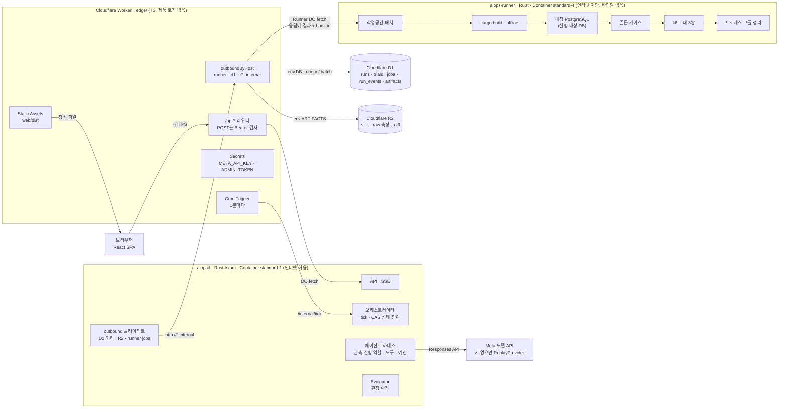
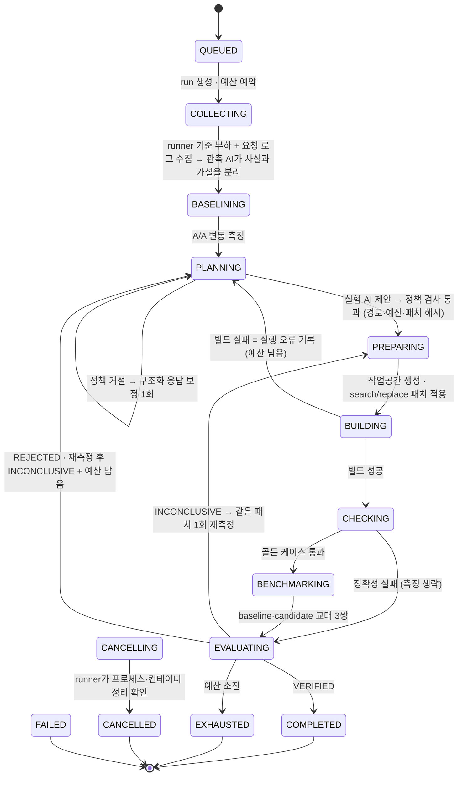
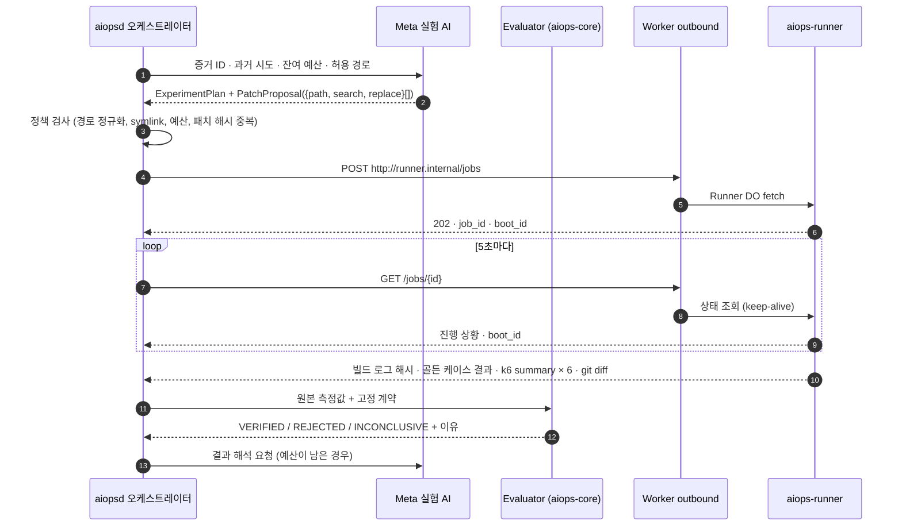

# 시스템 구조

English: [architecture.md](./architecture.md). 기준 문서: [plan.md](./plan.md). 그림으로 보는 버전은 Claude Artifact "AIOps 실험 엔지니어 구조도"에 있습니다.

## 1. 배포 구성

Worker는 라우팅, 인증, 컨테이너 수명, 바인딩 중계만 담당합니다. 제품 로직은 두 Rust 컨테이너에 있습니다. 컨테이너는 D1·R2·runner에 직접 닿지 못하고, 항상 Worker의 outbound handler를 거칩니다.

- 제어 DB는 D1(SQLite)입니다. 실험 대상 DB는 runner 안의 PostgreSQL입니다. 제품이 겨냥하는 사용자가 PostgreSQL을 운영하는 팀이어서 최적화 대상은 바꾸지 않았습니다.
- D1에는 대화형 트랜잭션이 없습니다. 상태 전이는 `state_version` CAS UPDATE로 하고 `meta.changes == 1`을 확인합니다. 함께 바뀌어야 하는 문장(상태 변경 + 이벤트 기록)은 하나의 트랜잭션인 `batch()`로 묶습니다.
- D1 행은 2 MB를 넘을 수 없습니다. 큰 로그와 raw 측정값은 R2에 두고, D1에는 해시·크기·키만 남깁니다.
- runner는 결과를 DB에 쓰지 않습니다. aiopsd가 polling 응답으로 결과를 받아 저장합니다. RunnerContainer에는 outbound handler가 없어서 runner 컨테이너는 D1·R2·API 키 어디에도 닿지 못합니다.
- polling은 상태 조회이면서 runner keep-alive 역할도 합니다. Container 내부에서 도는 코드는 activity로 치지 않기 때문입니다.
- Cron tick은 브라우저가 닫혀도 aiopsd가 멈추지 않게 합니다. tick이 돌 때마다 DB 상태를 기준으로 진행 중인 run을 이어 갑니다.

## 2. run 상태 전이

- 어느 상태에서든 취소 요청을 받으면 요청을 먼저 저장하고 `CANCELLING`으로 전이합니다. 정리가 확인된 뒤에만 `CANCELLED`로 확정합니다.
- 복구할 수 없는 오류가 나면 `FAILED`로 끝냅니다. 이전 trial의 기각 근거는 run이 어떻게 끝나든 남습니다.
- runner의 `boot_id`가 바뀌거나 runner가 job을 모른다고 답하면 그 job을 `lost`로 기록하고 한 번만 다시 제출합니다. runner가 재시작했다면 그 job의 프로세스와 작업공간은 이미 사라졌으므로 중복 실행이 생기지 않습니다. 종료 중인 runner는 새 job을 503으로 거절합니다.
- runner는 job의 단계 이력을 함께 돌려줍니다. polling 간격보다 짧게 끝난 단계(예: 정확성 검사)도 타임라인에 순서대로 남습니다.
- 측정이 흔들려 INCONCLUSIVE가 나오면 같은 패치를 한 번 더 측정합니다. 거절(REJECTED)된 패치는 다시 돌리지 않습니다.

## 3. 한 번의 trial (상태머신이 주도)

## 4. 판정 게이트 (위에서부터 처음 걸리는 게이트가 판정)

| 순서 | 조건 | 결과 |
| --- | --- | --- |
| 1 | 빌드 실패 · runner 오류 · 시간 초과 | 실행 오류 (판정 아님) |
| 2 | 골든 케이스 불일치 | REJECTED |
| 3 | A/A 변동 초과 · `dropped_iterations` > 0 · drain 미충족 | INCONCLUSIVE |
| 4 | 오류·timeout 증가 · OOM · 강제 종료 | REJECTED |
| 5 | 3쌍 개선율 중앙값 ≥ 20% 이고 방향 일치 | VERIFIED |
| 6 | 방향 엇갈림 | INCONCLUSIVE |
| 7 | 방향은 일치하지만 20% 미달 | REJECTED |

개선율은 `(baseline p95 − candidate p95) / baseline p95`로 계산하고, p95는 `http_req_duration{expected_response:true}` 기준입니다. 20%와 3쌍은 데모를 시작하기 위한 정책값입니다. 측정된 성과가 아닙니다.
