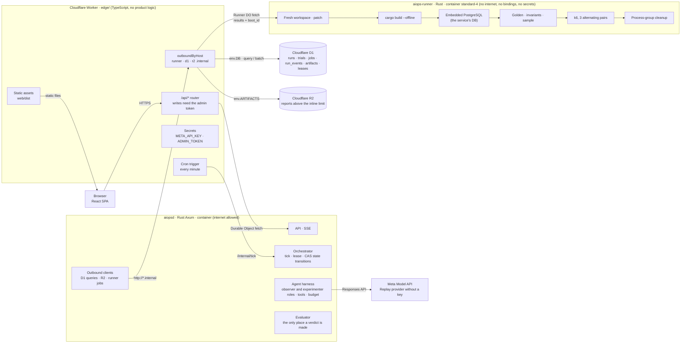
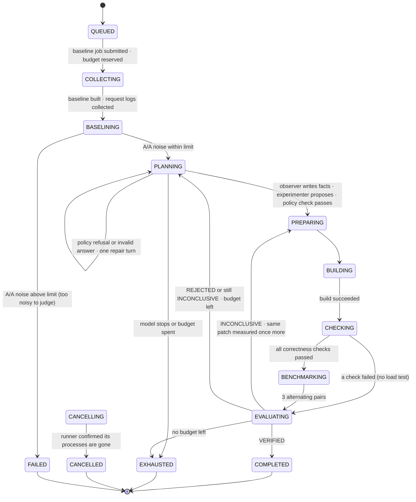
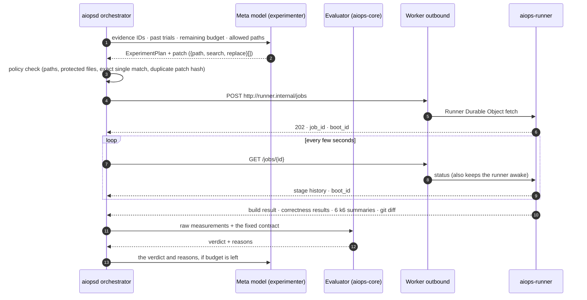

# Architecture

[한국어](./architecture.ko.md)

## 1. Deployment

The Worker only routes, authenticates, manages container lifetimes and relays bindings. The product logic lives in two Rust containers. Neither container reaches D1, R2 or the other container directly: every call goes through the Worker's outbound handlers.

- **Two databases.** The control DB (runs, trials, jobs, events) is D1. The service under test keeps its own PostgreSQL inside the runner, because the target user runs APIs on PostgreSQL.
- **No interactive transactions in D1.** A state transition is an `UPDATE ... WHERE state_version = ?` inside a `batch()` (one transaction) together with its event and job rows. A guard row records `changes()` right after the UPDATE; if it is 0, a CHECK constraint fails and the whole batch rolls back. A transition that loses the race therefore writes nothing.
- **One orchestrator at a time.** Only the instance holding the D1 lease ticks (TTL 60 s, renewed by a heartbeat). On SIGTERM, aiopsd finishes its tick and releases the lease. This was added after a rollout where an old and a new instance advanced the same run.
- **The runner holds nothing.** It has no outbound handler, so it cannot reach D1, R2 or the Meta API, and it has no secrets. aiopsd polls it and stores the results.
- **Keep-alive.** Code running inside a container does not count as activity. aiopsd's polling keeps the runner awake, and the 1-minute cron keeps aiopsd awake and resumes runs from the DB if it restarted.
- **Artifacts.** Reports up to the inline limit are stored in D1; larger ones go to R2 with only the hash, size and key in D1. The deployed limit is 4 KB, so every report goes through R2.

## 2. Run states

- A cancel request is stored first and moves the run to `CANCELLING` from any state. It becomes `CANCELLED` only after the runner confirms cleanup.
- If the runner's `boot_id` changes, or the runner no longer knows a job, the job is recorded as `lost` and submitted once more. A restarted runner has already lost that job's processes and workspace, so nothing runs twice. A runner that is shutting down refuses new jobs with 503.
- If the runner's report carries a different scenario hash than the run, the run stops with "scenario changed during the run". This catches a rollout that replaced the runner mid-run.

## 3. One trial

## 4. Gates

The first gate that fails decides the verdict. All thresholds come from the scenario contract (`scenarios/n-plus-one/scenario.toml`), which no model can edit. The 20% target and 3 pairs are policy values chosen for the demo, not measured results.

| Order | Condition | Verdict |
| --- | --- | --- |
| 1 | Patch refused by policy | POLICY_REJECTED |
| 1 | Runner error, build failure, the baseline itself breaks an invariant | EXECUTION_ERROR |
| 2 | A golden case, an invariant or a sampled response differs, or the candidate process dies | REJECTED |
| 3 | Fewer than 3 pairs completed, A/A noise or this trial's baseline spread above 15%, dropped iterations in the baseline | INCONCLUSIVE |
| 3 | The candidate falls behind the arrival rate while the baseline keeps up, and is slower | REJECTED |
| 4 | Error or timeout rate higher than the baseline's | REJECTED |
| 5 | Median pairwise p95 improvement ≥ 20% and every pair improved | VERIFIED |
| 6 | The candidate is slower, or every pair misses 20% by more than the measured noise | REJECTED |
| 7 | Anything else (pairs disagree, or close to the target) | INCONCLUSIVE |

The pairwise improvement is `(baseline p95 − candidate p95) / baseline p95`, with p95 taken over successful responses only. Failed requests are judged by gate 4.
